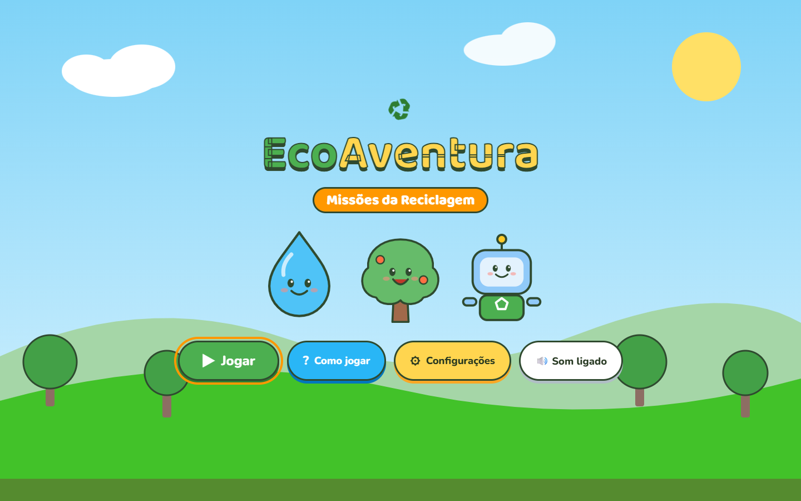
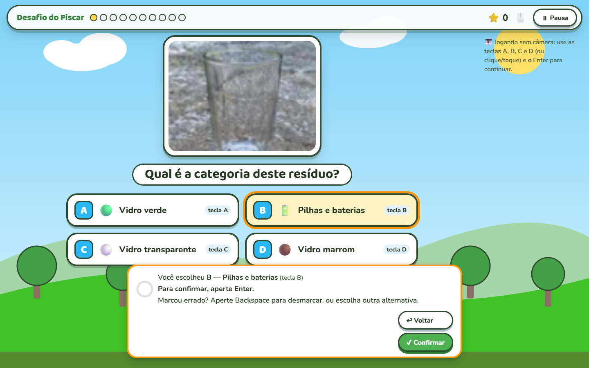
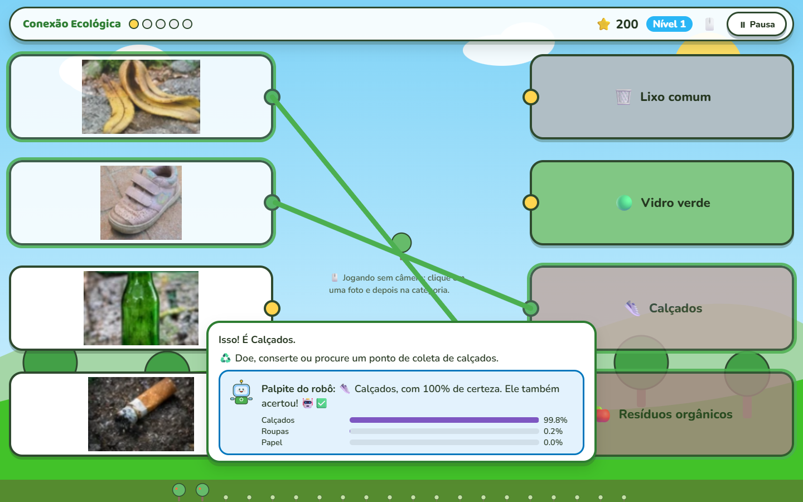
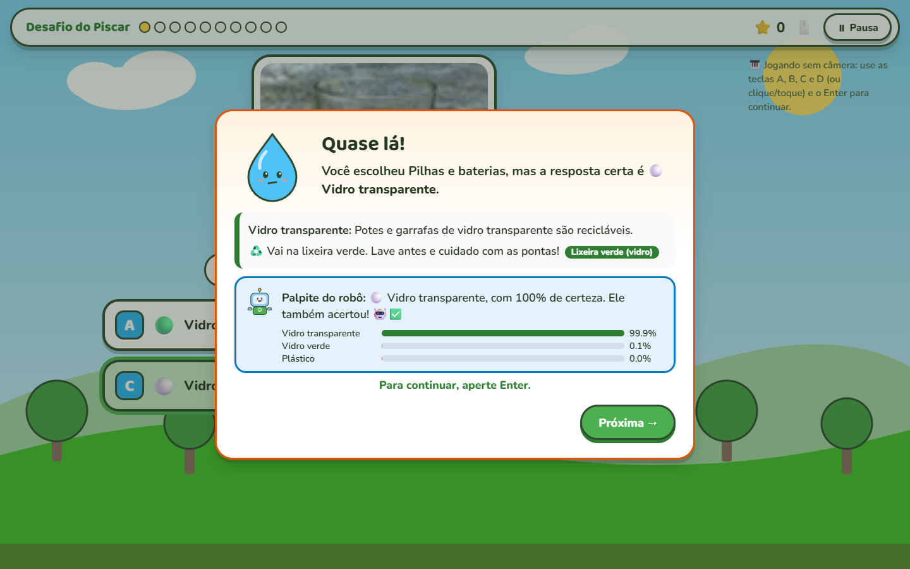
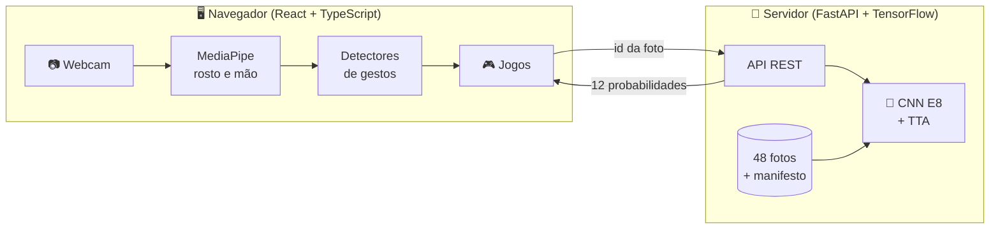

<div align="center">

# ♻️ EcoAventura — Missões da Reciclagem

**Jogos educativos sobre reciclagem, controlados pela webcam, com uma CNN que reconhece 12 tipos de resíduos.**

As crianças respondem **piscando os olhos** e ligam fotos às categorias **desenhando linhas no ar com o dedo** — sem mouse.




</div>

---

## 📑 Sumário

- [Sobre o projeto](#-sobre-o-projeto)
- [Os dois jogos](#-os-dois-jogos)
- [Machine Learning e visão computacional](#-machine-learning-e-visão-computacional)
- [Arquitetura](#-arquitetura)
- [Requisitos e sistemas suportados](#-requisitos-e-sistemas-suportados)
- [Instalação rápida](#-instalação-rápida)
- [Como jogar](#-como-jogar)
- [Modo de desenvolvimento](#-modo-de-desenvolvimento)
- [Testes](#-testes)
- [Publicar na internet (Cloudflare Tunnel)](#-publicar-na-internet-cloudflare-tunnel)
- [Estrutura de pastas](#-estrutura-de-pastas)
- [Detalhes técnicos](#-detalhes-técnicos)
- [Solução de problemas](#-solução-de-problemas)
- [Créditos](#-créditos)

---

## 🌱 Sobre o projeto

O **EcoAventura** é uma plataforma web educativa desenvolvida na disciplina **Tópicos Avançados em Tecnologia da
Informação** do **IFSP — Campus Votuporanga**. Ela une duas áreas:

| | O que faz | Onde roda |
|---|---|---|
| 🧠 **Machine Learning** | Uma CNN (**EfficientNetB0**, experimento **E8**) classifica a foto de cada material em 12 categorias | Servidor Python |
| 👀 **Visão computacional** | O **MediaPipe** encontra 478 pontos do rosto e 21 da mão; detectores próprios transformam isso em gestos | Navegador da criança |

**Privacidade em primeiro lugar:** o vídeo da câmera é processado só no navegador — nada é gravado nem enviado.
Para o servidor vai apenas o identificador da foto que o jogo quer classificar.

**A CNN não é o gabarito:** a resposta certa vem sempre do rótulo conferido por pessoas. O palpite do “robô” aparece
à parte e **nunca tira pontos** da criança.

---

## 🎮 Os dois jogos

<table>
<tr>
<td width="50%" valign="top">

### 👁️ Desafio do Piscar
Quiz de 10 perguntas sobre a categoria de cada material.

| Gesto | Ação |
|---|---|
| 1 piscada do olho esquerdo / direito | marca **A** / **B** |
| 2 piscadas do olho esquerdo / direito | marca **C** / **D** |
| Fechar os dois olhos por 1 s | **confirma** a resposta |
| Balançar a cabeça dizendo “não” | **desmarca** |

</td>
<td width="50%" valign="top">

### ☝️ Conexão Ecológica
Cinco rodadas ligando 4 fotos às suas categorias, com dificuldade progressiva.

| Gesto | Ação |
|---|---|
| Ponta do indicador | move o cursor (uma folhinha) |
| Juntar polegar e indicador (pinça) | puxa a linha |
| Abrir os dedos sobre a categoria | faz a ligação |
| Parar em cima (modo alternativo) | substitui a pinça |

</td>
</tr>
<tr>
<td></td>
<td></td>
</tr>
</table>

<div align="center">

<br><sub>Depois de cada resposta: o acerto, uma dica de descarte correto e, separado, o palpite da CNN com as probabilidades.</sub>
</div>

**Acessibilidade:** modos alternativos com a cabeça ou a boca, “parar em cima” no lugar da pinça, jogo **sem câmera**
(teclado, mouse ou toque), ajustes de sensibilidade e layout para computador, tablet e celular.

---

## 🧠 Machine Learning e visão computacional

### A CNN E8

| | |
|---|---|
| **Dataset** | [Garbage Classification (12 classes)](https://www.kaggle.com/datasets/mostafaabla/garbage-classification) — 15.515 imagens; 64 duplicatas removidas (SHA-256 + pHash) → **15.451** |
| **Divisão** | 10.815 treino · 2.318 validação · 2.318 teste (estratificada, semente 42) |
| **Modelo** | EfficientNetB0 pré-treinada no ImageNet + cabeça de 12 classes (4.215.087 parâmetros) |
| **Treino** | Fase 1: base congelada (10 épocas) · Fase 2: ajuste fino das últimas 40 camadas (taxa 0,00001) |
| **Entrada** | 128×128 RGB, pixels ÷ 255 (o modelo converte internamente para a escala da EfficientNet) |
| **Teste original** | **94,3% de acurácia · F1 macro 0,920** |
| **48 fotos novas** | 77,1% → **85,4%** com TTA (média de 4 versões da foto, sem retreinar) |

Foram 9 experimentos (E0–E8). As CNNs próprias pararam em F1 0,77; a transferência de aprendizado chegou a **0,943**.

### O que roda no navegador

- **Piscadas como sinal no tempo:** cada olho vira um nível 0–1 calibrado por criança, com histerese (0,65/0,35),
  duração mínima, janela de 900 ms para piscada dupla e descarte quando a cabeça está se mexendo.
- **Pinça normalizada:** distância polegar–indicador ÷ tamanho da mão — funciona perto ou longe da câmera.
- **Cursor suave:** coordenadas espelhadas e filtro *One Euro* (tira o tremor sem atrasar).

Detalhes completos em [Detalhes técnicos](#-detalhes-técnicos) e no relatório do projeto.

---

## 🏗️ Arquitetura



---

## 💻 Requisitos e sistemas suportados

| Programa | Versão | Para quê |
|---|---|---|
| [Python](https://www.python.org/downloads/) | **3.10, 3.11, 3.12 ou 3.13** (recomendado 3.12) — **3.14 ainda não funciona** | Servidor e CNN |
| [Node.js](https://nodejs.org/) | **20 ou mais novo** | Construir o site |
| Navegador | Chrome, Edge ou Firefox atualizados | Jogar (a câmera precisa de `localhost` ou HTTPS) |
| Webcam | qualquer uma | Opcional — dá para jogar sem câmera |

| Sistema | Situação |
|---|---|
| 🪟 **Windows 10/11 (64 bits)** | ✅ Testado — instalação do zero com `instalar.bat` |
| 🐧 **Linux x86_64 ou ARM64** (Ubuntu 18.04+, Debian 10+, Fedora…) | ✅ Compatível — o TensorFlow 2.21 tem pacote oficial; use `instalar.sh` |
| 🍎 **macOS com Apple Silicon (M1, M2, M3, M4)**, macOS 12+ | ✅ Compatível — o TensorFlow 2.21 tem pacote oficial; use `instalar.sh` |
| 🍎 macOS com processador **Intel** | ⚠️ Não suportado: o TensorFlow 2.21 não publica pacote para Mac Intel. Alternativa: rodar em Linux (máquina virtual) |

> Linux e macOS foram verificados pela disponibilidade oficial dos pacotes e por revisão do código (sem nada específico
> de Windows); a instalação completa foi testada no Windows.

<details>
<summary><b>Como instalar Python e Node em cada sistema</b></summary>

**Windows** (PowerShell):
```powershell
winget install Python.Python.3.12
winget install OpenJS.NodeJS.LTS
```

**macOS** (com [Homebrew](https://brew.sh)):
```bash
brew install python@3.12 node
```

**Ubuntu / Debian**:
```bash
sudo apt update
sudo apt install python3 python3-venv python3-pip
# Node 20+: https://nodejs.org/en/download (o "nodejs" do apt costuma ser antigo)
```
Se o `python3` da sua distribuição for 3.14 ou mais novo, instale também um 3.12 (por exemplo com `pyenv` ou `uv`).

</details>

---

## 🚀 Instalação rápida

**1. Baixe o projeto**

```bash
git clone https://github.com/SEU-USUARIO/ecoaventura.git
cd ecoaventura
```
(ou use **Code → Download ZIP** no GitHub e extraia a pasta)

**2. Instale e inicie**

| | 🪟 Windows | 🍎 macOS / 🐧 Linux |
|---|---|---|
| Instalar (uma vez, ~5 min) | dê dois cliques em **`instalar.bat`** | `bash instalar.sh` |
| Iniciar o jogo | dê dois cliques em **`iniciar_servidor.bat`** | `bash iniciar_servidor.sh` |

O instalador confere as versões do Python e do Node, cria o ambiente do servidor (`backend/.venv`), instala o
TensorFlow e as demais dependências e constrói o site.

**3. Abra** <http://localhost:8000> no navegador e permita a câmera quando ele pedir. 🎉

> Para parar, feche a janela do servidor (Windows) ou aperte **Ctrl+C** (macOS/Linux).
> Depois de mudar o código do site, inicie com `--construir` para reconstruí-lo.

---

## 🕹️ Como jogar

1. **Jogar** → escolha a missão.
2. Clique em **Ligar câmera** (ou **Jogar sem câmera**).
3. Siga a **calibração**: o jogo aprende como são os seus olhos (ou a sua mão) — leva uns 30 segundos.
4. Jogue! Em **Configurações** dá para trocar o jeito de responder, ajustar tempos e sensibilidade e ligar o
   **modo de apresentação**, que mostra informações técnicas da CNN.

**Dicas para a câmera funcionar bem:** rosto ou mão bem iluminados, de frente para a câmera, a uns 50–80 cm de distância.

---

## 🔧 Modo de desenvolvimento

Com recarregamento automático do site — use dois terminais:

<table>
<tr><th>🪟 Windows (PowerShell)</th><th>🍎 macOS / 🐧 Linux</th></tr>
<tr><td>

```powershell
# terminal 1 — servidor
cd backend
.venv\Scripts\python -m uvicorn main:app --port 8000 --reload

# terminal 2 — site
cd frontend
npm run dev
```

</td><td>

```bash
# terminal 1 — servidor
cd backend
.venv/bin/python -m uvicorn main:app --port 8000 --reload

# terminal 2 — site
cd frontend
npm run dev
```

</td></tr>
</table>

Abra <http://localhost:5173>. O Vite encaminha `/api` e `/imagens` para a porta 8000.

---

## ✅ Testes

| Onde | Comando | Casos |
|---|---|---|
| Servidor (com o modelo real) | `cd backend` e depois `.venv/bin/python -m pytest -q` (Windows: `.venv\Scripts\python -m pytest -q`) | 12 |
| Site (gestos, pontuação, sorteio) | `cd frontend` e depois `npm test` | 47 |

Os testes do site simulam quadros da câmera para verificar piscadas simples e duplas, piscadas involuntárias,
confirmação, o “não” com a cabeça, a pinça e as regras dos jogos. Roteiro de testes manuais com câmera:
[docs/TESTES.md](docs/TESTES.md).

---

## 🌐 Publicar na internet (Cloudflare Tunnel)

O jogo inteiro (site + API + CNN) roda em um único endereço, `http://localhost:8000`, que o Cloudflare Tunnel publica
com HTTPS (o navegador só libera a câmera em HTTPS fora do `localhost`).

1. Inicie o servidor (`iniciar_servidor.bat` ou `bash iniciar_servidor.sh`). Nesse modo ele só classifica fotos do
   próprio jogo e limita requisições por visitante.
2. Instale o [`cloudflared`](https://developers.cloudflare.com/cloudflare-one/connections/connect-networks/downloads/)
   e rode, como administrador, o comando que o painel da Cloudflare mostra: `cloudflared service install <TOKEN>`.
   **Nunca coloque o token em arquivos do projeto.**
3. No painel (*Zero Trust → Networks → Tunnels → Public Hostname*): **Type `HTTP`**, **URL `localhost:8000`**.
4. O computador precisa ficar ligado com o servidor rodando.

---

## 📁 Estrutura de pastas

```text
ecoaventura/
├── instalar.bat / instalar.sh              ← instalação (Windows / macOS e Linux)
├── iniciar_servidor.bat / iniciar_servidor.sh
├── backend/                                ← Python + FastAPI
│   ├── main.py                             ← API e entrega do site
│   ├── inference.py                        ← CNN E8: carga, validação, pré-processamento, TTA
│   ├── model/                              ← melhor_modelo.keras + JSONs do treino
│   └── tests/
├── frontend/                               ← React + TypeScript + Vite
│   ├── public/mediapipe/                   ← modelos do MediaPipe (o WASM é copiado na instalação)
│   └── src/
│       ├── vision/                         ← rosto, piscadas, mão, pinça, suavização
│       ├── games/                          ← Desafio do Piscar, Conexão Ecológica, sorteio
│       ├── components/ pages/ services/ context/ styles/
│       └── __tests__/
├── data/
│   ├── imagens_jogos/<classe>/             ← 48 fotos novas (4 por classe)
│   └── imagens_jogos.json                  ← manifesto: id, classe, origem, hashes
├── ferramentas/                            ← recorte, cadastro e avaliação das fotos
└── docs/                                   ← testes e imagens do README
```

---

## 📚 Detalhes técnicos

<details>
<summary><b>Como o servidor carrega e protege a CNN</b></summary>

Na inicialização, `backend/inference.py`:

1. carrega **somente** `melhor_modelo.keras` (nunca procura outro `.keras`);
2. confere a ordem das 12 classes em `classes.json` e `preprocessamento.json`;
3. confere que `metadados_modelo.json` e `selecao_modelo.json` indicam o experimento **E8**;
4. valida entrada `128×128×3`, saída com 12 unidades e softmax;
5. confere o número de parâmetros (4.215.087) com o registrado;
6. confirma a camada interna `Rescaling(255)` — prova de que o modelo espera pixels de 0 a 1;
7. faz um aquecimento e mantém o modelo em memória.

**Pré-processamento idêntico ao treino:** `decode_image(channels=3)` → `resize(128, 128, bilinear)` → `float32 / 255`.
Não há segunda normalização. As camadas de aumento de dados ficam inativas (`training=False`).

**TTA:** a foto original, a espelhada, um recorte central de 90% e o espelho dele vão num único lote; o resultado é a
média das probabilidades. Variável `ECO_TTA`: `espelho_recorte` (padrão), `espelho` ou `desligado`.

| Método | Rota | Descrição |
|---|---|---|
| `GET` | `/api/saude` | Estado do modelo e das verificações |
| `POST` | `/api/classificar` | `imagem_id` (ou `arquivo`, se `ECO_PERMITIR_UPLOAD=1`) → classe, confiança e 12 probabilidades |
| `GET` | `/api/imagens` | Fotos dos jogos |
| `GET/POST` | `/api/pontuacoes` | Pontuações locais (sem nome, foto ou dado biométrico) |

</details>

<details>
<summary><b>Detecção de gestos</b></summary>

- **Calibração:** olhos abertos → só o esquerdo fechado → só o direito fechado. O sistema descobre qual sinal do
  MediaPipe é cada olho da criança, mede aberto/fechado de cada um e quanto o outro “fecha junto”.
- **Piscada válida:** fecha (nível ≥ 0,65) e reabre (≤ 0,35) em 150 ms a 1,5 s, com só aquele olho fechado em 75%
  dos quadros. Piscadas dos dois olhos, curtas demais ou com a cabeça em movimento são ignoradas.
- **Preparo:** cada pergunta começa com 2,5 s de “Prepare-se!”, e um gesto só vale após ~1 s de olhos abertos e
  cabeça parada.
- **Confirmar:** os dois olhos fechados por 1 s (ou boca aberta, configurável).
- **Voltar:** três viradas rápidas de cabeça em até 1,6 s.
- **Pinça:** distância das pontas do polegar e do indicador ÷ tamanho da mão, com dois limiares (histerese) e
  confirmação em 2 quadros; falhas curtas do rastreamento não soltam a linha.
- **Cursor:** espelhado, os 70% centrais da câmera viram a tela inteira, filtro One Euro.

</details>

<details>
<summary><b>Fotos dos jogos e avaliação da CNN</b></summary>

As 48 fotos (4 por classe) foram recortadas de uma grade por `ferramentas/recortar_grade.py` e cadastradas por
`ferramentas/registrar_imagens.py`, que compara cada uma (SHA-256 e dHash) com as 15.451 imagens do dataset de treino —
nenhuma repetida. Para trocar ou adicionar fotos:

1. coloque as fotos em `data/imagens_jogos/<classe>/` (a pasta é o rótulo);
2. rode `ferramentas/registrar_imagens.py` com o Python do `backend/.venv`;
3. confira cada foto e marque `"revisada": true` no `data/imagens_jogos.json`;
4. `ferramentas/avaliar_generalizacao.py` gera acurácia, F1 e matriz de confusão em `data/relatorios/`.

</details>

<details>
<summary><b>Desempenho e privacidade</b></summary>

- Câmera em 480×360; o MediaPipe analisa até 20 quadros/s (ajustável); a tela só redesenha quando algo muda; a câmera
  desliga sozinha fora dos jogos.
- TensorFlow limitado a 2 núcleos (`ECO_TF_THREADS`), inferência fora do laço principal, cache de 256 resultados.
- Nenhum vídeo, rosto ou ponto do rosto é gravado; calibrações ficam só na memória da aba.

</details>

---

## 🩺 Solução de problemas

| Problema | Solução |
|---|---|
| “Instale o Python 3.10… 3.13” | Você tem só o Python 3.14 ou mais antigo que 3.10. Instale o 3.12 (veja [Requisitos](#-requisitos-e-sistemas-suportados)). |
| `ensurepip is not available` (Linux) | `sudo apt install python3-venv` e rode o instalador de novo. |
| `No matching distribution found for tensorflow` | Python 3.14, Mac Intel ou Linux 32 bits. Use Python 3.12 em um sistema suportado. |
| A câmera não liga | Clique no cadeado ao lado do endereço e permita a câmera. No **macOS**: Ajustes do Sistema → Privacidade e Segurança → Câmera → ative o navegador. Feche outros apps que usem a câmera. |
| “Endereço já em uso” na porta 8000 | Outro programa usa a porta. Feche-o, ou rode o uvicorn com `--port 8001` e abra `localhost:8001`. |
| O jogo abre, mas o “robô” não responde | Veja <http://localhost:8000/api/saude>: `modelo_carregado` deve ser `true`. |
| Gestos “sensíveis demais” | Em Configurações, aumente a duração mínima da piscada e o tempo de preparo. |
| `bash: ./instalar.sh: Permission denied` | Rode com `bash instalar.sh` (não precisa de permissão de execução). |

---

## 🙌 Créditos

- **Autora:** Micheli M. Corsino
- **Orientação:** Prof. Ivan Lopes — *Tópicos Avançados em Tecnologia da Informação*, IFSP — Campus Votuporanga
- **Dataset:** [Garbage Classification (12 classes)](https://www.kaggle.com/datasets/mostafaabla/garbage-classification), autor `mostafaabla` (Kaggle)
- **Modelos de visão:** [MediaPipe](https://ai.google.dev/edge/mediapipe) Face Landmarker e Hand Landmarker (Google, Apache 2.0)
- **Modelo base:** EfficientNetB0 (Keras Applications, pesos ImageNet)
